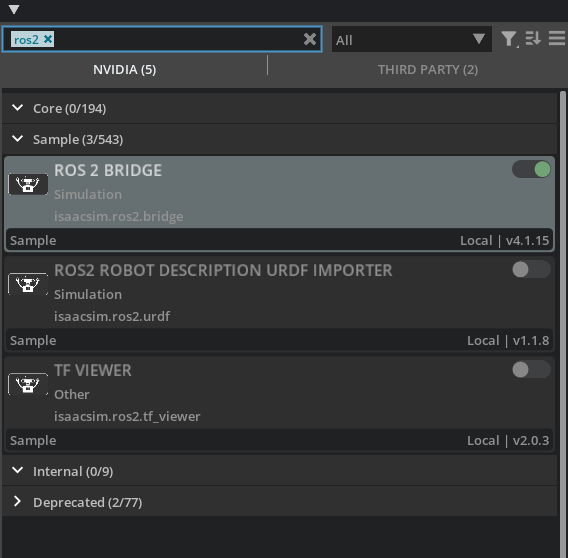
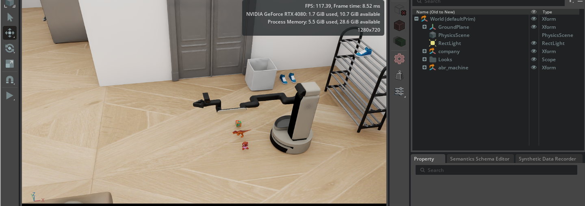

# 目的与适用范围

- 支持平台与版本范围
  - Ubuntu  22.04
  - Isaac Sim 4.5
  - ROS2 humble
  - NVIDIA GeForce RTX 3070（最低要求）

# 文件及资源说明

## 目录说明

├── machine/ 

├── models/ 

├── scene/ 

└── scripts/ 

- machine

机器人本体相关资源（USD，机构定义）

- models

3d模型与资产库（mesh、材质等）

- scene

示例场景，环境入口

- scripts

光心坐标转换等

## 机器模块

机器目前分为如下几个模块：

├── base/ # 底盘与机体基座

├── lift/ # 升降机构

├── wheels/ # 轮组（驱动轮/万向轮）

├── head/ # 头部与传感器安装结构

├── gripper/ # 夹爪末端执行器

└── arms/ # 机械臂关节链与连杆结构

最终通过abr_machine_assembly将模块聚合

## 传感器及控制器说明

**头部upper相机**

- prim位置：

/Root/robot_root/head/berxel_upper_base_link/upper_camera

- 关联omnigraph：

/Root/robot_root/head/ros_cameras_upper

**头部tof相机**

- prim位置：

/Root/robot_root/head/tof_top_link/tof_camera

- 关联omnigraph：

/Root/robot_root/head/ros_cameras_tof

**手部相机**

- prim位置：

/Root/robot_root/arms/berxel_arm_base_link/berxel_arm_color_optical_frame/arm_camera

- 关联omnigraph：

/Root/robot_root/arms/ros_camera_arm

**差分控制器**

- 关联omnigraph：

/Root/robot_root/base/different_ctrl

**激光雷达**

- prim位置：

/Root/robot_root/base/base_scan/Lidar

- 关联omnigraph:

  /Root/robot_root/base/lidars

**关节控制器**

- 关联omnigraph：

 /Root/robot_root/arms/arm_ctrl

**里程计**

- 关联omnigraph：

/Root/robot_root/base/transform_tree

## ros2消息说明

| 话题名称                                                     | 数据             | 数据类型                    |
| ------------------------------------------------------------ | ---------------- | --------------------------- |
| /actuator/motor/joint/ctrl                                   | 机械臂控制       | sensor_msgs/msg/JointState  |
| /berxel_arm/berxel_arm/aligned_depth_to_color/camera_info_ori | 手部相机内参     | sensor_msgs/msg/CameraInfo  |
| /berxel_arm/berxel_arm/aligned_depth_to_color/image_raw_isaac | 手部相机深度数据 | sensor_msgs/msg/Image       |
| /berxel_arm/berxel_arm/color/camera_info_ori                 | 手部相机内参     | sensor_msgs/msg/CameraInfo  |
| /berxel_arm/berxel_arm/color/image_raw_ori                   | 手部相机RGB      | sensor_msgs/msg/Image       |
| /berxel_arm/raw/berxel_cloudpoint_ori                        | 手部相机点云     | sensor_msgs/msg/PointCloud2 |
| /berxel_upper/berxel_upper/aligned_depth_to_color/camera_info_ori | 头部相机内参     | sensor_msgs/msg/CameraInfo  |
| /berxel_upper/berxel_upper/aligned_depth_to_color/image_raw_isaac | 头部相机深度     | sensor_msgs/msg/Image       |
| /berxel_upper/berxel_upper/color/camera_info_ori             | 头部相机内参     | sensor_msgs/msg/CameraInfo  |
| /berxel_upper/berxel_upper/color/image_raw_ori               | 头部相机RGB      | sensor_msgs/msg/Image       |
| /berxel_upper/raw/berxel_cloudpoint_ori                      | 头部相机点云     | sensor_msgs/msg/PointCloud2 |
| /tof/camera_info_ori                                         | tof相机内参      | sensor_msgs/msg/CameraInfo  |
| /tof/depth_image_ori                                         | tof相机深度数据  | sensor_msgs/msg/Image       |
| /tof/point_cloud_ori                                         | tof相机点云      | sensor_msgs/msg/PointCloud2 |
| /clock                                                       | 时钟             | rosgraph_msgs/msg/Clock     |
| /joint_states                                                | 机器所有关节     | sensor_msgs/msg/JointState  |
| /odom                                                        | 里程计           | nav_msgs/msg/Odometry       |
| /scan_raw                                                    | 激光雷达         | sensor_msgs/msg/LaserScan   |

# 环境准备

## Isaac Sim 4.5下载连接

 https://download.isaacsim.omniverse.nvidia.com/isaac-sim-standalone-4.5.0-linux-x86_64.zip

## ROS2 安装

版本：ROS2 humble

## Isaac Sim4.5 与 ROS2 桥接配置

1. 打开isaacsim
2. 选择Window→Extensions
3. 搜索栏搜索ros2
4. 将结果中的 ROS 2 BRIDGE  勾选

# 场景运行

1. 将仿真资源包解压到 ~/Downloads下，或任意指定目录下

2. 打开isaacsim

3. 选择File→Open 然后选中上述资源中的 scene/abr_scene.usd 加载成功后界面如图所示

   

4. 点击左边菜单栏play按钮,可看到机械臂回收

5. 输入ros2 topic list 可看到相关ros的topic已经正常发出，本次比赛涉及到的topic

   - /actuator/motor/joint/ctrl    机械臂控制
   - /joint_states  关节状态

备注：2-4步骤也可自行通过脚本实现

